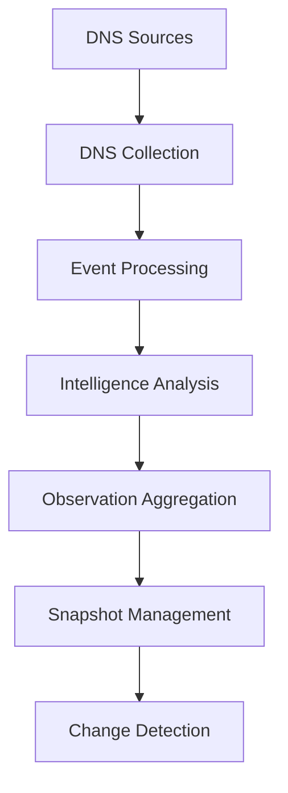

# KEM3T

**Network Intelligence & Infrastructure Analysis**

KEM3T is a network-focused security engineering project designed to explore network infrastructure discovery, event processing, intelligence analysis, and change detection.

The project combines networking concepts with information security to help identify network assets, analyze observations, and detect changes in infrastructure over time.

## Current Features

- DNS reconnaissance and record collection
- Structured event processing
- Network observation aggregation
- DNS snapshot management
- Infrastructure change detection
- Context-aware execution and error handling
- Automated testing, including race detection

## Architecture



## Project Goals

KEM3T is being developed to explore practical approaches to network intelligence and infrastructure analysis, with an emphasis on:

- Network discovery and visibility
- Information security research
- Event-driven architecture
- Infrastructure monitoring
- Detection of changes in observed assets
- Reliable and testable security engineering

## Technology

- Go
- DNS
- Event-driven processing
- Automated testing

Go is the implementation language; the primary focus is networking, infrastructure intelligence, and information security.

## Project Status

KEM3T is under active development.

The current implementation includes DNS collection, event processing, observation aggregation, snapshot management, and change detection.

Future development may expand collection capabilities, service identification, infrastructure analysis, and security-focused intelligence.

## Testing

Run the test suite:

```bash
go test -race -count=1 ./...
```

Run the demonstration mode:

```bash
go run ./cmd/kem3t demo
```

Run DNS collection mode:

```bash
go run ./cmd/kem3t dns
```

## Disclaimer

KEM3T is intended for authorized security research, educational purposes, and infrastructure analysis. Only assess systems you own or have explicit permission to test.
