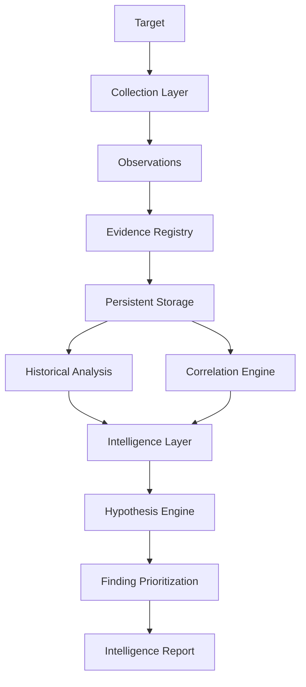

<div align="center">

# KEM3T

### NETWORK INTELLIGENCE & INFRASTRUCTURE ANALYSIS


*Discover. Analyze. Correlate. Investigate.*

</div>

---

## Overview

KEM3T is a research-oriented networking and information security project focused on infrastructure discovery, evidence management, historical analysis, and explainable intelligence generation.

Instead of treating every collection operation as an isolated result, KEM3T maintains persistent evidence and historical context so that observations can be compared, correlated, and interpreted over time.

The system is designed to help answer questions such as:

- What infrastructure is associated with a target?
- What changed between observations?
- Which observations are related?
- What hypotheses can be formed from the available evidence?
- Which findings deserve further investigation?
- What evidence supports a particular conclusion?

KEM3T does not treat correlations or hypotheses as proof. They are investigative leads that should be independently validated.

---

## Current Features

### DNS Collection and Historical Analysis

KEM3T collects DNS-related observations, stores snapshots, and compares subsequent collections to identify address changes.

Implemented capabilities include DNS collection, baseline creation, persistent snapshots, historical comparison, and change reporting.

### TCP Port Discovery

KEM3T supports TCP connection checks over a configurable port range. Open-port observations are integrated with evidence generation and infrastructure graph construction.

This is connection-based port discovery, not comprehensive service fingerprinting or vulnerability detection.

### TLS Certificate Inspection

KEM3T includes a TLS pipeline and CLI mode that can collect certificate subject, issuer, negotiated TLS version, verification status, and SHA-256 fingerprint.

TLS results can be represented in the infrastructure graph and analyzed by the intelligence layer.

Supported CLI modes include:

- Demo mode
- DNS collection mode
- Historical analysis mode

### Evidence Management

Collected observations can be represented as persistent evidence.

The evidence system provides:

- Evidence registration
- Evidence validation
- Persistent storage
- Evidence references
- Collection run tracking
- Observation tracking

This provides a foundation for analyzing infrastructure over time instead of relying only on the latest collection result.

### Historical Analysis

KEM3T can compare historical DNS observations and identify changes between collection points.

This allows investigation of:

- DNS record additions
- DNS record removals
- Changed values
- Historical differences between observations

### Correlation Analysis

The intelligence layer can correlate related observations and identify relationships between pieces of collected evidence.

Correlations are treated as analytical signals rather than confirmed facts.

### Hypothesis Generation

KEM3T can generate investigative hypotheses from available evidence.

Hypotheses can include:

- Supporting evidence references
- Alternative explanations
- Verification steps
- Supporting observations

This keeps analytical conclusions explainable and provides a path for validating them.

### Finding Prioritization

The intelligence pipeline can prioritize findings using rule-based analysis.

Prioritization provides a structured starting point for further investigation by distinguishing potentially important findings from lower-priority observations.

### Intelligence Reports

KEM3T can combine evidence, correlations, hypotheses, and prioritized findings into an intelligence-oriented report.

The analytical flow is:

```text
Observation
    ↓
Evidence
    ↓
Correlation
    ↓
Hypothesis
    ↓
Prioritization
    ↓
Intelligence Report
```

---

## Architecture



The architecture separates collection, evidence, analysis, and intelligence stages so that future infrastructure relationships can be added without replacing the existing foundation.

---

## Technology Stack

- Go
- DNS
- SQLite
- Event-driven processing
- Automated testing

Go is used as the implementation language.

The project itself focuses on networking, infrastructure intelligence, reverse engineering, and information security.

---

## Project Structure

The repository is organized around the following responsibilities:

- `cmd/kem3t/` — CLI entry point
- `internal/changes/` — Change detection
- `internal/collectors/` — Demo, DNS, TCP, and TLS collection
- `internal/events/` — Collection events
- `internal/evidence/` — Evidence registry and persistence
- `internal/graph/` — Infrastructure relationship graph
- `internal/intelligence/` — Analysis, hypotheses, and reporting
- `internal/integration/` — Integration tests
- `internal/pipeline/` — Collection and analysis orchestration
- `internal/snapshots/` — DNS snapshot handling

Unit tests are maintained alongside the implementation, with integration tests covering interactions between components.

---

## Installation

Clone the repository:

```bash
git clone https://github.com/itsFuRy007/kem3t.git
cd kem3t
```

Build the project:

```bash
go build ./...
```

Run the test suite:

```bash
go test ./...
```

---

## Usage

Display the available CLI options:

```bash
go run ./cmd/kem3t -h
```

Run the demonstration mode:

```bash
go run ./cmd/kem3t -mode demo
```

Run DNS collection for a target:

```bash
go run ./cmd/kem3t -mode dns -target example.com
```

Run historical analysis for a target:

```bash
go run ./cmd/kem3t -mode history -target example.com
```

The default DNS snapshot directory is:

```text
.kem3t/snapshots
```

It can be changed with:

```text
-snapshot-dir <directory>
```

For the complete list of available options:

```bash
go run ./cmd/kem3t -h
```

---

## Testing

KEM3T is developed with an emphasis on correctness and reproducibility.

Run the standard test suite:

```bash
go test -count=1 ./...
```

Run tests with the race detector:

```bash
go test -race -count=1 ./...
```

Run static analysis:

```bash
go vet ./...
```

Verify Go modules:

```bash
go mod verify
```

Check formatting:

```bash
gofmt -l .
```

Check Git whitespace errors:

```bash
git diff --check
```

---

## Project Status

KEM3T is under active development.

The current development milestone establishes the foundation for persistent evidence and intelligence analysis.

The implemented intelligence pipeline includes:

- Evidence registration and validation
- Persistent evidence storage
- Collection runs
- Observations
- DNS historical comparison
- Correlation analysis
- Hypothesis generation
- Alternative explanations
- Evidence-linked verification steps
- Rule-based finding prioritization
- Intelligence reporting
- DNS pipeline integration

The project has progressed beyond its original DNS-focused foundation. TCP port discovery, TLS certificate inspection, initial infrastructure graph construction, and related integration tests are now implemented. Release readiness must still be verified before publishing a version.

---

## Development Roadmap

The roadmap below separates implemented capabilities from planned work.

### Completed

- [x] DNS collection and historical snapshots
- [x] DNS change detection
- [x] Persistent evidence registration and validation
- [x] Collection run and observation tracking
- [x] TCP port discovery over configurable ranges
- [x] TLS certificate inspection
- [x] Initial infrastructure graph construction
- [x] TCP pipeline integration with evidence and graph generation
- [x] TLS pipeline integration with graph output
- [x] Correlation analysis and hypothesis generation
- [x] Alternative explanations and evidence-linked verification steps
- [x] Rule-based finding prioritization and intelligence reporting
- [x] Unit and integration tests for implemented workflows

### Planned: Collection and Infrastructure Modeling

- [ ] Expand infrastructure entity and relationship types
- [ ] Improve service identification beyond basic TCP port discovery
- [ ] Strengthen relationships between domains, addresses, services, and certificates
- [ ] Normalize observations across collection modes
- [ ] Add further cross-pipeline integration scenarios

### Planned: Intelligence Quality

- [ ] Expand correlation and relationship-detection rules
- [ ] Improve evidence provenance and traceability
- [ ] Refine confidence and uncertainty representation
- [ ] Expand historical analysis across observation types
- [ ] Improve finding prioritization and verification logic

### Planned: Reliability and Usability

- [ ] Review concurrency limits and timeout behavior
- [ ] Improve error handling and operational diagnostics
- [ ] Expand regression and edge-case testing
- [ ] Add structured report export options
- [ ] Establish reproducible release and verification procedures

Roadmap items are future goals, not claims of existing functionality.

### Infrastructure Graph Modeling

Model relationships between infrastructure entities such as:

- Domains
- Subdomains
- IP addresses
- DNS records
- Services
- Certificates
- Hosting infrastructure

The goal is to move from isolated observations toward connected infrastructure intelligence.

### Expanded Collection

Extend collection capabilities beyond the current DNS-focused foundation.

Potential areas include:

- Service discovery
- Infrastructure identification
- Certificate intelligence
- Network metadata
- Additional passive and active observations

### Advanced Intelligence Analysis

Expand the intelligence layer with richer:

- Correlation techniques
- Relationship detection
- Change analysis
- Evidence scoring
- Hypothesis generation
- Confidence modeling

### Security Analysis

Add security-oriented analysis and validation capabilities built on top of collected infrastructure intelligence.

### Reporting and Visualization

Improve how intelligence is consumed through:

- Structured reports
- Export formats
- Infrastructure relationship visualization
- Investigation-oriented views

### Reliability and Performance

Continue improving:

- Test coverage
- Concurrency
- Persistence reliability
- Error handling
- Performance
- Operational robustness

---

## Responsible Use

KEM3T is intended for legitimate security research, infrastructure analysis, authorized testing, and educational purposes.

Only collect or analyze infrastructure that you are authorized to investigate.

The presence of an observation, correlation, or hypothesis in KEM3T should not be interpreted as proof of malicious activity or ownership. Findings should be independently validated before being used for security decisions.

---

## License

KEM3T is licensed under the MIT License.

See the [LICENSE](LICENSE) file for the full license text.
