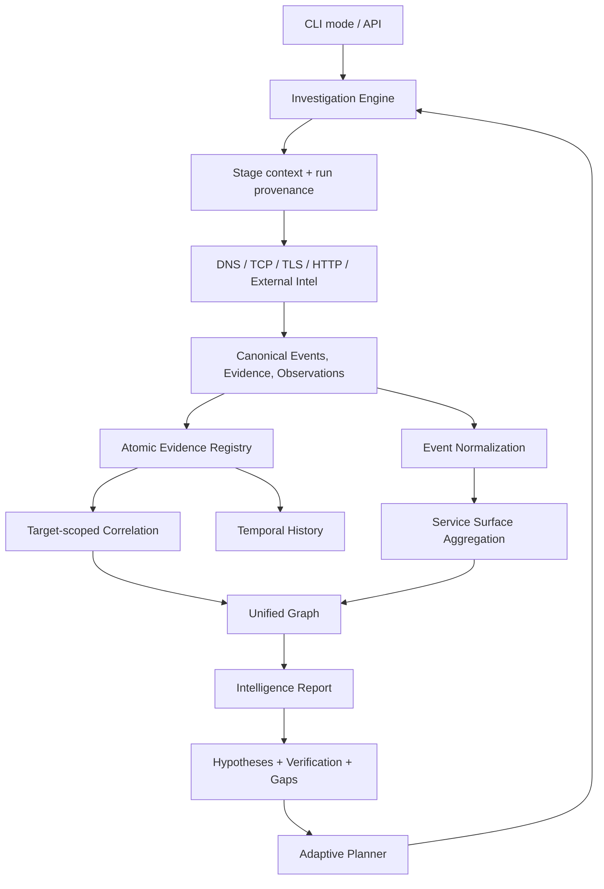

# KEM3T Execution and Intelligence Architecture

KEM3T uses one investigation lifecycle for its collection modes. CLI commands and compatibility APIs select stages; they do not own separate persistence, graph, reporting, or history implementations.

## Execution flow

## Shared contracts

- **Evidence** represents a fact with a stable identity. Retrieval time does not belong in the identity of a fact.
- **Observation** represents when and where a fact was observed. Collection run and stage provenance are attached here.
- **StageResult** returns counts plus the canonical events, evidence records, and observation records produced by the stage.
- Evidence and observations are persisted together through the registry's atomic batch APIs. Duplicate facts may be reused; conflicting payloads that reuse an evidence ID are rejected.
- Normalization is performed once by the investigation engine. Service indicators are applied chronologically so an older observation cannot overwrite a newer value.
- The graph and intelligence report are built from the same target-scoped registry state.

## Intelligence responsibilities

The intelligence layer is not just a formatter for collector output. It correlates evidence, discovers relationships and pivots, creates testable hypotheses with explicit confidence and limitations, evaluates verification evidence, identifies intelligence gaps, prioritizes findings, and produces an investigation plan.

After each stage, the engine builds a current intelligence report and passes it to the adaptive planner together with evidence, observations, findings, completed stages, and scheduled stages. The planner can therefore reason from correlations, discoveries, hypotheses, gaps, and proposed investigation-plan items—not just raw collector output. It may add bounded follow-up stages; it must not silently broaden the authorized target scope.

A hypothesis is an interpretation to test, not a statement of fact. Its supporting evidence, alternative explanations, limitations, and verification steps must remain visible to the researcher.

## Failure semantics

- A stage failure does not erase successful results from other stages.
- A partial run is persisted as failed/partial rather than presented as a complete success.
- CLI adapters return a non-zero error for partial investigations so automation can distinguish them from complete runs.
- History snapshots are persisted only after successful run finalization.
- Active collection remains bounded to the explicitly supplied target and authorized scope.

## Compatibility APIs

The standalone DNS, TCP, TLS, and HTTP pipeline APIs retain their result types for callers, but delegate execution to the same investigation engine. External-intelligence CLI modes use engine stages as well. This keeps existing entry points while avoiding independent lifecycle implementations.
